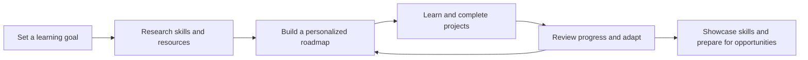
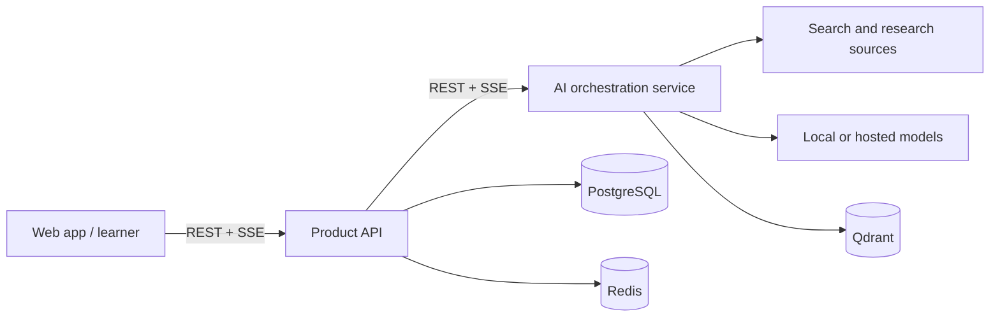

<div align="center">

# Soch.ai

### Think. Learn. Build.

**An AI-powered career intelligence platform designed to turn a learning goal into an adaptive, evidence-based path to career readiness.**

[](#project-status)
[](https://nodejs.org/)
[](https://pnpm.io/)
[](LICENSE)

</div>

---

## The idea

Learning a new skill for a career can mean piecing together outdated roadmaps, scattered tutorials, and generic advice—with no useful signal about what to do next. **Soch.ai is being designed to bring that journey into one adaptive workspace.**

Rather than treating learning as a checklist, Soch.ai's product vision is to connect **current research, structured learning, hands-on projects, and career outcomes**. A learner shares their goal, experience, available time, and preferred learning style; the platform is designed to turn that context into a personalized plan that can evolve as they make progress.

> **The goal:** help learners spend less time figuring out what to learn and more time building proof of what they can do.

## What makes the approach different

- **Research-backed recommendations:** ground learning resources in discoverable sources, with freshness and quality considered—not just a static list.
- **Adaptive roadmaps:** plan around a learner's goals and schedule, then adjust as their progress and priorities change.
- **Build as you learn:** connect topics to progressively challenging projects and portfolio evidence.
- **Outcome-oriented progress:** focus on demonstrated skills, interview practice, and job readiness—not just time spent or lessons completed.
- **AI with context:** design the mentor and coach around the learner's roadmap, progress, and cited sources.

These are **product goals**, not claims that the features are already live. See [Project status](#project-status).

## Product journey



The roadmap is intended to span **Beginner → Intermediate → Advanced**, with topics, resources, milestones, and projects linked to a clear career goal.

## Architecture

The system is planned as a typed monorepo with distinct product, API, and AI-service boundaries:



### Planned stack

| Area | Planned technology |
| --- | --- |
| Web experience | Next.js, React, TypeScript |
| Product API | NestJS, TypeScript, REST and server-sent events |
| AI orchestration | FastAPI, Python, LangGraph |
| Data | PostgreSQL, Prisma |
| Background work and cache | Redis, BullMQ |
| Semantic search | Qdrant |
| Local development infrastructure | Docker Compose; Ollama is an optional model runtime |
| Monorepo | pnpm workspaces, Turborepo |

The architecture and technology choices are documented in [System Architecture](docs/02-architecture.md). The working repository currently contains the initial monorepo configuration, infrastructure definition, and Prisma schema; the planned web, API, and AI applications are not implemented yet.

## Repository map

```text
.
├── docs/                         # Product, architecture, API, AI, security, and delivery plans
├── packages/
│   └── database/
│       └── prisma/schema.prisma  # Initial PostgreSQL data model
├── docker-compose.yml            # Local infrastructure service definitions
├── .env.example                  # Configuration template (no production secrets)
├── package.json                  # Workspace scripts and toolchain requirements
├── pnpm-workspace.yaml
└── turbo.json
```

### Product and engineering docs

| Document | What it covers |
| --- | --- |
| [Product requirements](docs/01-prd.md) | Learners, product principles, requirements, and success measures |
| [System architecture](docs/02-architecture.md) | Services, communication, data flow, and technology decisions |
| [Database schema](docs/03-database-schema.md) | Initial data model |
| [API specification](docs/04-api-specification.md) | Planned product API contracts |
| [AI agents](docs/05-ai-agents.md) | Agent roles and orchestration |
| [UI wireframes](docs/06-ui-wireframes.md) | Product experience concepts |
| [Component hierarchy](docs/07-component-hierarchy.md) | Planned frontend structure |
| [Folder structure](docs/08-folder-structure.md) | Monorepo layout plan |
| [Development roadmap](docs/09-development-roadmap.md) | Delivery phases and milestones |
| [Testing strategy](docs/10-testing-strategy.md) | Planned quality and evaluation approach |
| [Security](docs/11-security.md) | Security principles and design considerations |

## Project status

**Early development — foundation and product design.** This repository currently includes product and engineering specifications, workspace configuration, a Prisma schema, and Docker Compose definitions. The application services and end-to-end learner experience are planned work; this is not yet a deployed or feature-complete platform.

The first product milestone is a focused vertical slice: onboarding for one learning domain, research-backed roadmap generation, and a roadmap experience. Further milestones cover projects and progress tracking, coaching, interview preparation, and career-readiness features.

For scope and sequencing, see the [development roadmap](docs/09-development-roadmap.md).

## Getting started

### Requirements

- [Node.js](https://nodejs.org/) 20 or newer
- [pnpm](https://pnpm.io/) 9 or newer
- [Docker Compose](https://docs.docker.com/compose/) for local infrastructure

### Install workspace dependencies

```bash
git clone https://github.com/Hugarabhi/Soch.ai.git
cd Soch.ai
pnpm install
```

### Start selected local data services

The Compose file defines PostgreSQL, Redis, Qdrant, Ollama, and an OpenTelemetry Collector. You can start the data services independently:

```bash
docker compose up -d postgres redis qdrant
```

The PostgreSQL development credentials and service URLs in the Compose file are for **local development only**. Do not reuse them in a deployed environment.

> **Current limitation:** the application services and their workspace packages have not been added yet, so `pnpm dev` does not currently launch a working Soch.ai application. Setup instructions will expand as those services are implemented.

## Contributing

Soch.ai is being built in the open. Before opening a pull request:

1. Read the [product requirements](docs/01-prd.md) and [architecture](docs/02-architecture.md) to understand the intended direction.
2. Keep implementation aligned with the [roadmap](docs/09-development-roadmap.md), or explain the proposed change.
3. Include focused tests and update relevant documentation when adding behavior.
4. Never commit `.env` files, credentials, or other secrets. Use `.env.example` for placeholders.

## License

Distributed under the [MIT License](LICENSE).

---

<div align="center">

**Soch.ai — Think. Learn. Build.**

Built by [Avinash Hugar](https://github.com/Hugarabhi)

</div>
